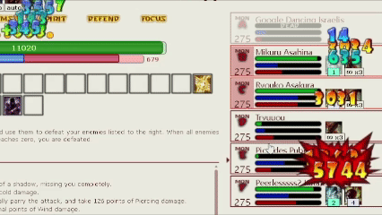

# HV DDTank Battle Damage Numbers

A Tampermonkey/Violentmonkey userscript for [HentaiVerse](https://hentaiverse.org) that reads the battle log and pops classic Flash/ddtank-style damage numbers — DDTank-flavored — over monsters and your character: red digits for physical, colored digits per element, a crit backplate, and green healing numbers.



- **Zero dependencies, fully self-contained** — the digit atlas is embedded as base64, no external requests.
- **Read-only** — it never touches game state; everything is parsed from the DOM battle log.
- **Bilingual log parsing** — understands both English and Chinese battle log lines.
- **Module-friendly API** — other scripts can subscribe to parsed damage events, render their own numbers, or take over the native renderer entirely.

---

## Install

You need a userscript manager: [Tampermonkey](https://www.tampermonkey.net/) or Violentmonkey.

**One-click install (recommended, auto-updates via jsDelivr):**

```
https://cdn.jsdelivr.net/gh/1415ddfer/hv-ddtank-battle-damage@main/hv-ddtank-battle-damage.user.js
```

**Fallback (GitHub raw):**

```
https://raw.githubusercontent.com/1415ddfer/hv-ddtank-battle-damage/main/hv-ddtank-battle-damage.user.js
```

Open either link with a userscript manager installed and it will offer to install the script. Then open any HentaiVerse battle — numbers appear on their own.


## What you get

| Number style | Shown for |
|---|---|
| Red digits | Physical (crushing / slashing / piercing) |
| Colored elemental digits | Fire, Cold (→ water glyphs), Elec (→ land glyphs), Wind, Holy (→ light glyphs), Dark, Void (custom pale-pink) |
| Red backplate + scale pop | Critical hits |
| Green digits with `+` icon | Healing on the player |

Animation replicates the original ddtank stepper: rise-and-fade for normal hits, scale-up pop for crits, 24 fps, up to 8-digit values.

## Configuration

The script runs out of the box. To tweak it, open the browser console during a battle:

```js
// Bigger and faster numbers (scale 0.4–2.5, speed 0.1–3)
unsafeWindow.HVBattleDamage.configure({ scale: 1.4, speed: 1.2 });

// Inspect what the module is doing
unsafeWindow.HVBattleDamage.inspect();
```

## API for other scripts

The script publishes a frozen, read-only API at `unsafeWindow.HVBattleDamage`:

```js
const api = unsafeWindow.HVBattleDamage;
await api.ready;

// Subscribe to every parsed damage event (heals excluded)
const unsubscribe = api.subscribe(event => {
  // { target, amount, element, critical, text, ... }
  console.log(event);
});

// Parse log lines yourself
api.parse('You crit Konata for 12,345 points of fire damage.');
// → { target: 'Konata', amount: 12345, element: 'fire', critical: true, ... }

// Render a one-off number (e.g. from your own module)
await api.emit({ target: 'Konata', amount: 777, element: 'holy', critical: true });

// Take over the native renderer entirely (named lease, release to hand back)
const lease = api.takeover('MyBattleModule');
// ... later: lease.release();
```

Useful members: `mappings`, `parse`, `parseBatch`, `parseHealing`, `parseEvents`, `configure`, `assets.createSprite`, `takeover`, `subscribe`, `emit`, `sample`, `pause`, `clear`, `refresh`, `inspect`, `stop`.

## Compatibility

- HentaiVerse battle UI, top frame only (`@noframes`).
- Plays nicely with log-translating scripts: translated history rows are ignored, only original current entries produce numbers.
- Pauses when the tab is hidden; clears automatically when the Riddlemaster interrupts a battle.

## Repository layout

```
hv-ddtank-battle-damage/
├── hv-ddtank-battle-damage.user.js   # the userscript (install this)
├── assets/
│   └── preview.gif                # README / forum preview image
├── README.md
└── LICENSE
```

## Credits

- DOM adapter lineage: JPX 261015b1 and HVMonsterDB 2.1.1 (read-only parsing approach).
- Damage composition, frame stepping and element mapping replicate the original ddtank implementation; glyphs were extracted from the game's own SWF assets.

## License

[MIT](LICENSE). Game assets remain the property of their respective owners; this project is an unofficial fan-made enhancement.
